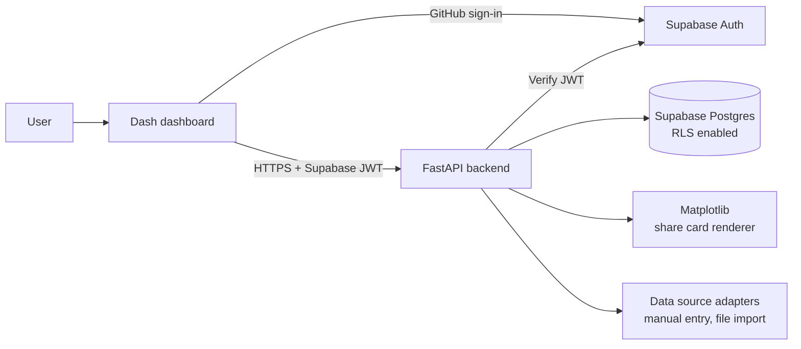

# fitness-tracker
# Fitness Tracker with Social Features


Set fitness goals, log daily activity, see progress in interactive dashboards, and share chosen achievements with friends.

> **Project status: in development.** This README describes the intended design. Items in the [Roadmap](#roadmap) are only ticked once they have been built and tested. No integration with a wearable or fitness service exists unless the roadmap says so.

## Table of contents

- [Overview](#overview)
- [Features](#features)
- [Tech stack](#tech-stack)
- [Architecture](#architecture)
- [Fitness data sources](#fitness-data-sources)
- [Data model](#data-model)
- [Getting started](#getting-started)
- [Environment variables](#environment-variables)
- [Project structure](#project-structure)
- [API overview](#api-overview)
- [Privacy and sharing model](#privacy-and-sharing-model)
- [Security](#security)
- [Testing](#testing)
- [Design decisions](#design-decisions)
- [Known limitations](#known-limitations)
- [Roadmap](#roadmap)
- [Screenshots](#screenshots)
- [Licence](#licence)

## Overview

Progress tracking is often scattered across apps, and trends are hard to spot. This project connects three ideas: personal **goals**, **visualised progress**, and optional **social accountability** through sharing achievements with a chosen audience.

## Features

| Feature | Description |
|---|---|
| GitHub sign-in | Authentication through Supabase Auth with the GitHub provider. |
| Goals | Create goals such as weekly distance, active minutes, workouts per week or streaks. |
| Activity logging | Quick-add form, edit and delete, plus file import with a preview. |
| Dashboards | Interactive charts: weekly trends, goal progress, activity calendar. |
| Achievements | Awarded by rules (goal met, streak milestone, personal best), once each. |
| Share cards | Static shareable images generated with Matplotlib. |
| Friends | Send, accept, decline and block requests, plus a feed of shared achievements. |
| Privacy controls | Every achievement is private by default, with per-item visibility. |

## Tech stack

| Layer | Technology | Purpose |
|---|---|---|
| Dashboard UI | [Dash](https://dash.plotly.com/) (Plotly) | Interactive dashboards |
| Static visuals | [Matplotlib](https://matplotlib.org/) | Shareable achievement images |
| Backend | [FastAPI](https://fastapi.tiangolo.com/) | REST API, business logic |
| Database and auth | [Supabase](https://supabase.com/) | Postgres, Row Level Security, GitHub OAuth |
| Validation | Pydantic v2 | Schemas and settings |
| Tooling | pytest, Ruff, GitHub Actions | Tests, linting, CI |

Dash is built on Plotly, so interactive charts use Plotly figures. Matplotlib is used on the backend for static images only.

## Architecture



### GitHub sign-in flow

GitHub login is an authentication option that must be configured. It is not automatic in Supabase:

1. A GitHub OAuth App is registered, with its callback URL set to the Supabase project's auth callback (`https://<project-ref>.supabase.co/auth/v1/callback`).
2. The GitHub client ID and secret are entered in the Supabase dashboard under Authentication, Providers.
3. The app's own URLs are added to Supabase's allowed redirect list.
4. The user is redirected to GitHub, then back to Supabase, then to the app with a session. The access token is sent to FastAPI, which verifies it on every protected route.

## Fitness data sources

Data enters the system through a `FitnessDataSource` adapter interface, so sources can be added without changing the core.

| Source | Status |
|---|---|
| Manual entry | Planned |
| File import (CSV, GPX, TCX) with preview and de-duplication | Planned |
| Google Fit API | **Not planned.** The Google Fit APIs are being retired and are not open to new projects, so no integration is claimed. |
| Android Health Connect | **Not applicable to this architecture.** It reads data on the device only and cannot be called from a web backend. |
| Other provider with a supported web API | Future option, subject to review |

Importing the same file twice must never create duplicate activities.

## Data model

Planned tables (Row Level Security on all of them):

- `profiles`: handle, display name, avatar.
- `goals`: type, target, unit, period, dates, status.
- `activities`: type, date, duration, distance, source, external ID (unique per user and source for de-duplication).
- `achievements`: type, linked goal, earned date, visibility (`private`, `friends`, `public`).
- `friendships`: requester, addressee, status (`pending`, `accepted`, `blocked`), unique pair.
- `shares`: which achievement was shared, with which audience.

Schema changes are managed as migrations in `supabase/migrations/`.

## Getting started

> The commands below describe the intended workflow. Confirm them against the final repository layout and update this section when the build is complete.

### Prerequisites

- Python 3.11 or newer
- [Supabase CLI](https://supabase.com/docs/guides/cli)
- A Supabase project
- A GitHub OAuth App (see [GitHub sign-in flow](#github-sign-in-flow))
- Git

### 1. Clone

```bash
git clone https://github.com/mojalefa100/fitness-tracker.git
cd fitness-tracker
```

### 2. Install dependencies

```bash
python -m venv .venv
source .venv/bin/activate        # Windows: .venv\Scripts\activate
pip install -r backend/requirements.txt
pip install -r frontend/requirements.txt
```

### 3. Configure environment variables

```bash
cp .env.example .env
```

Fill in the values below. Never commit `.env`.

### 4. Set up the database

```bash
supabase link --project-ref <your-project-ref>
supabase db push
```

### 5. Run the backend

```bash
uvicorn backend.app.main:app --reload --port 8000
```

### 6. Run the dashboard

```bash
python frontend/app.py
```

## Environment variables

| Variable | Used by | Description |
|---|---|---|
| `SUPABASE_URL` | Backend, frontend | Supabase project URL. |
| `SUPABASE_ANON_KEY` | Frontend | Public anon key. |
| `SUPABASE_SERVICE_ROLE_KEY` | Backend only | Privileged key. Never expose or commit it. |
| `SUPABASE_JWT_SECRET` | Backend | For verifying tokens (or use the project's JWKS). |
| `FRONTEND_ORIGIN` | Backend | Allowed CORS origin. |
| `API_BASE_URL` | Frontend | Backend address. |

GitHub's client ID and secret are configured in the Supabase dashboard, not in this repository.

## Project structure

Proposed layout (will be updated to match the final repository):

```
.
├── backend/
│   ├── app/
│   │   ├── main.py
│   │   ├── routers/
│   │   ├── services/        # goals, activities, achievements, social, share cards
│   │   ├── adapters/        # FitnessDataSource implementations
│   │   ├── repositories/
│   │   ├── schemas/
│   │   └── core/
│   ├── tests/
│   └── requirements.txt
├── frontend/
│   ├── app.py
│   ├── pages/
│   └── requirements.txt
├── supabase/
│   └── migrations/
├── docs/                    # architecture decision records
├── .env.example
└── README.md
```

## API overview

Planned endpoints (final contract in the generated OpenAPI docs):

| Area | Examples |
|---|---|
| Goals | `GET/POST /goals`, `PATCH/DELETE /goals/{id}` |
| Activities | `GET/POST /activities`, `POST /activities/import` |
| Progress | `GET /progress/summary?from=&to=` |
| Achievements | `GET /achievements`, `PATCH /achievements/{id}/visibility` |
| Friends | `GET /friends`, `POST /friends/requests`, `POST /friends/requests/{id}/accept` |
| Feed | `GET /feed` |
| Share cards | `GET /achievements/{id}/card.png` |

All routes except the health check require a valid Supabase JWT.

## Privacy and sharing model

- Achievements are **private by default**.
- A friend can see an achievement only if the friendship is accepted **and** the achievement's visibility allows it. This is enforced in database policies, not only in application code.
- Blocked users and non-friends see nothing.
- Friends never see email addresses or raw activity data, only the achievements a user has chosen to share.
- Users can export and delete their data.

## Security

- Row Level Security on every table.
- The service-role key stays on the backend.
- JWT verification on every protected route.
- Uploads are validated by type and size, and imports are previewed before they are committed.
- CORS restricted to the frontend origin.
- Rate limiting on expensive endpoints such as imports and image rendering.

## Testing

```bash
pytest
ruff check .
```

Planned coverage: progress calculations (including time-zone and week-boundary handling), idempotent achievement awarding, import de-duplication, validation and error paths, and database-level tests that a non-friend, a blocked user, and a friend of a private achievement cannot read it.

## Design decisions

Recorded as short architecture decision records in `docs/`.

- **Dash frontend versus mounting inside FastAPI.** Dash is a separate Flask-based app. Serving it as its own frontend that calls the FastAPI backend, or mounting it through WSGI middleware, will be compared before one is chosen.
- **Plotly for interactivity, Matplotlib for static images.** Matplotlib figures are not interactive in Dash, so they are used only to render share cards.
- **Data-source adapters.** A single interface keeps the core independent of any one provider and lets the app work today with manual entry and file import.
- **Session handling in Dash.** Dash keeps no per-user server session by default, so where the session lives (cookie or browser storage) is decided and documented with its security tradeoffs.

## Known limitations

- No live wearable or fitness-service sync.
- Activity types and metrics will be limited to a small supported set in the first version.
- This is not a medical or coaching tool.

## Roadmap

- [ ] Define the MVP and supported activity types
- [ ] GitHub sign-in spike (full round trip in Dash)
- [ ] Database schema, migrations and RLS policies
- [ ] Goal creation and progress calculation
- [ ] Activity logging and file import
- [ ] Interactive dashboards
- [ ] Achievements and share cards
- [ ] Friends, feed and privacy controls
- [ ] Access-control and validation tests
- [ ] Responsive and accessibility review
- [ ] Deployment

## Screenshots

Screenshots will be added once the interface is working.

## Licence

To be decided.

## Author

Mojalefa Moletsane ([GitHub](https://github.com/mojalefa100) · [LinkedIn](https://www.linkedin.com/in/mojalefa-moletsane-3bb034150))